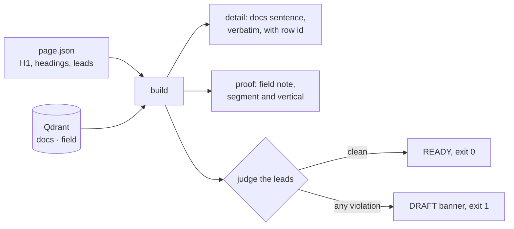

# page-engine

**One path from evidence to a product page, where every detail is a docs sentence and every authored word is judged in code.**

You write the H1, the section headings and a short lead for each bullet. The engine supplies the
rest verbatim from your sources: the detail under each lead, the hero subline, the customer proof.
Then it checks your words against the facts they introduce. A page with a violation is a draft, and
the build exits 1 so a publish step can refuse it.

Built on [field-kit](https://github.com/meinsta/field-kit). Reads the collection that
[grounding-layer](https://github.com/meinsta/grounding-layer) keeps current.

## Get started

```bash
git clone https://github.com/meinsta/page-engine && cd page-engine
pip install -r requirements.txt
python3 test_offline.py                          # no cluster, no keys

export QDRANT_URL=... QDRANT_API_KEY=...         # the cluster grounding-layer refreshed
python3 -m pageengine.build                      # page.json -> out/api-security.product.md
python3 -m pageengine.build --track paid         # the paid landing cut
```

## Who writes what



| Part of the page | Written by | Rule |
|---|---|---|
| H1, section headings | You | An H1 must exist |
| Lead of each bullet | You | At most 12 words, different from its sentence, states no number the sentence lacks, and retrieves its own fact at rank 1 |
| Detail of each bullet | The index | A docs sentence, verbatim, with the id of its row |
| Hero subline | The index | The first docs sentence on the page |
| Customer proof | The index | A field note, described by segment and vertical |
| Call to action | You | Repeated per section on a product page; once on a paid landing |

Two tracks run on the same path. The product page keeps every section. The paid landing keeps the
first three and a single call to action.

## What we found

Run on a Qdrant Cloud cluster over the Quillfeather fixtures, with the page shipped here:

| Run | Result |
|---|---|
| Product page | READY: 4 sections, 6 bullets, every detail verbatim with its row id |
| Paid cut | READY: 3 sections, 1 call to action |
| A lead that says 72 hours where the docs say 24 | DRAFT: the number is not in its sentence |
| A lead that copies its sentence | DRAFT: over 12 words, and repeats its sentence |
| "Sleep well at night" as a lead | DRAFT: it does not retrieve its own fact |

Two things the first runs taught, both now in the shipped settings:

- The lead audit started at rank 3. With 14 docs sentences in the lane, "Sleep well at night" passed
  by chance. It runs at rank 1 now.
- One bullet's pointer question fetched the wrong sentence, so a lead about 90 days sat above a
  sentence about 24 hours. The number check caught it, and the pointer was rewritten.

## What the judge does not do

It checks length, repetition, numbers and retrieval. It does not read for tone, and a lead with no
number can still say more than its sentence does. Headings and the H1 are checked only for
presence.

## Not here yet

The guide landing track, rendering to HTML, and the memory of past verdicts that feeds a model
writing the leads.

## Make it yours

Edit [`page.json`](page.json). Each bullet has a `lead` you write and a `q` that points at the
docs sentence it introduces. Each section has a `proof` phrase that points at a field note.
