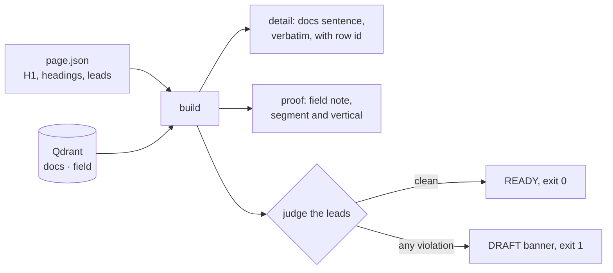

# page-engine

**Build product pages from evidence: the docs supply every detail, and code judges every word you write.**

You write a bullet that says keys rotate with a 72-hour overlap. The docs say 24. The page ships,
and a customer finds the gap.

Here you write the H1, the section headings and a short lead for each bullet. The engine supplies
the rest verbatim from your sources: the detail under each lead, the hero subline and the customer
proof. Then it checks your words against the facts they introduce. The engine marks a page with a
violation DRAFT and the build exits 1, so your publish step can hold it.

Built on [field-kit](https://github.com/meinsta/field-kit). Reads the collection that
[grounding-layer](https://github.com/meinsta/grounding-layer) keeps current.

## Run It on the Sample Company

```bash
git clone https://github.com/meinsta/page-engine && cd page-engine
pip install -r requirements.txt
python3 test_offline.py                          # runs offline

export QDRANT_URL=... QDRANT_API_KEY=...         # the cluster grounding-layer refreshed
python3 -m pageengine.build                      # page.json -> out/api-security.product.md
python3 -m pageengine.build --track paid         # the paid landing cut
```

## Write the Leads and Let the Index Supply the Facts



This table shows who writes each part of the page and the rule that part must pass.

| Page Part | Author | Rule |
|---|---|---|
| H1, section headings | You | The page has an H1 |
| Lead of each bullet | You | At most 12 words, worded differently from its sentence, with every number taken from that sentence, and it retrieves its own fact at rank 1 |
| Detail of each bullet | The index | A docs sentence, verbatim, with the id of its row |
| Hero subline | The index | The first docs sentence on the page |
| Customer proof | The index | A field note, described by segment and vertical |
| Call to action | You | Repeated per section on a product page, and shown once on a paid landing |

Both tracks run on the same path. The product page keeps every section. The paid landing keeps
the first three sections and shows the call to action once.

## See the Results Measured on a Live Cluster

On a Qdrant Cloud cluster with the Quillfeather fixtures, the page shipped here built as follows:

| Run | Result |
|---|---|
| Product page | READY, with 4 sections and 6 bullets, every detail verbatim with its row id |
| Paid cut | READY, with 3 sections and 1 call to action |
| A lead that says 72 hours where the docs say 24 | DRAFT: the number is missing from its sentence |
| A lead that copies its sentence | DRAFT: over 12 words, and it repeats its sentence |
| "Sleep well at night" as a lead | DRAFT: it fails to retrieve its own fact |

The first live runs changed two of the shipped settings:

- The lead audit started at rank 3. With 14 docs sentences in the lane, "Sleep well at night"
  passed by chance, so the audit now runs at rank 1.
- A bullet's pointer question fetched the wrong sentence, which put a lead about 90 days above a
  sentence about 24 hours. The number check caught it, and I rewrote the pointer.

## Read for Tone Yourself

The judge checks length, repetition, numbers and retrieval. Tone stays with you, and so does a
lead with no number in it, which can still promise more than its sentence does. The judge checks
that an H1 exists and leaves the wording of headings to you.

## See What This Kit Adds Next

A guide-landing track, HTML output, and a memory of past verdicts for a model that writes the
leads.

## Point It at Your Own Page

Edit [`page.json`](page.json). Each bullet has a `lead` you write and a `q` that points at the
docs sentence it introduces. Each section has a `proof` phrase that points at a field note.
